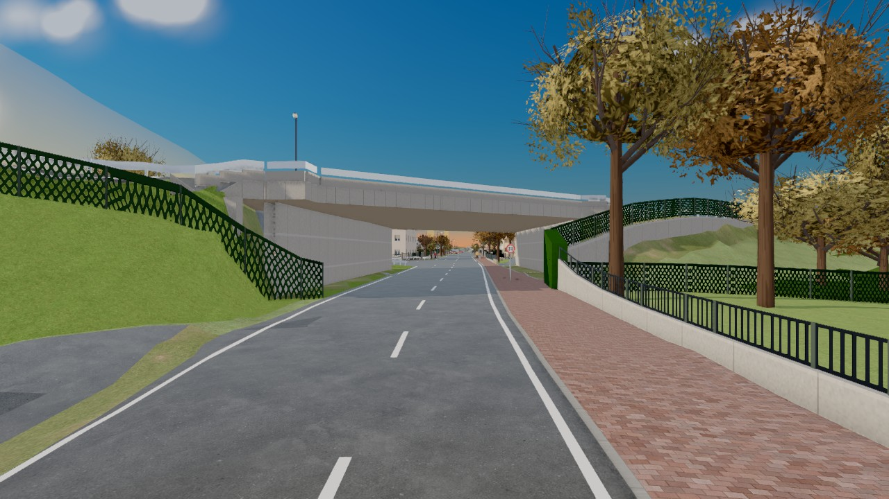
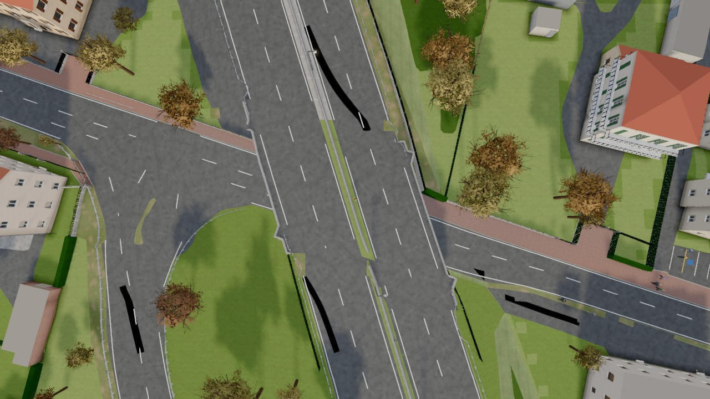
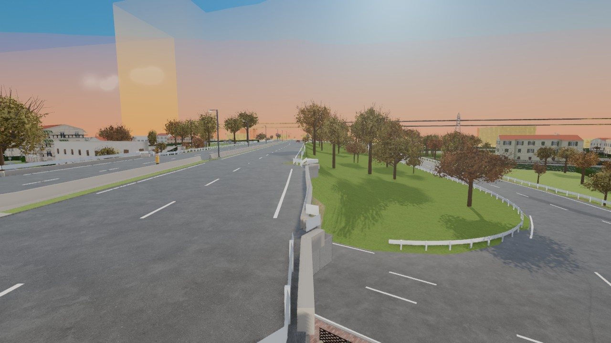
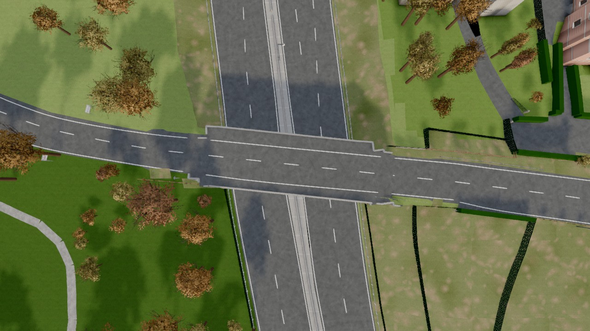
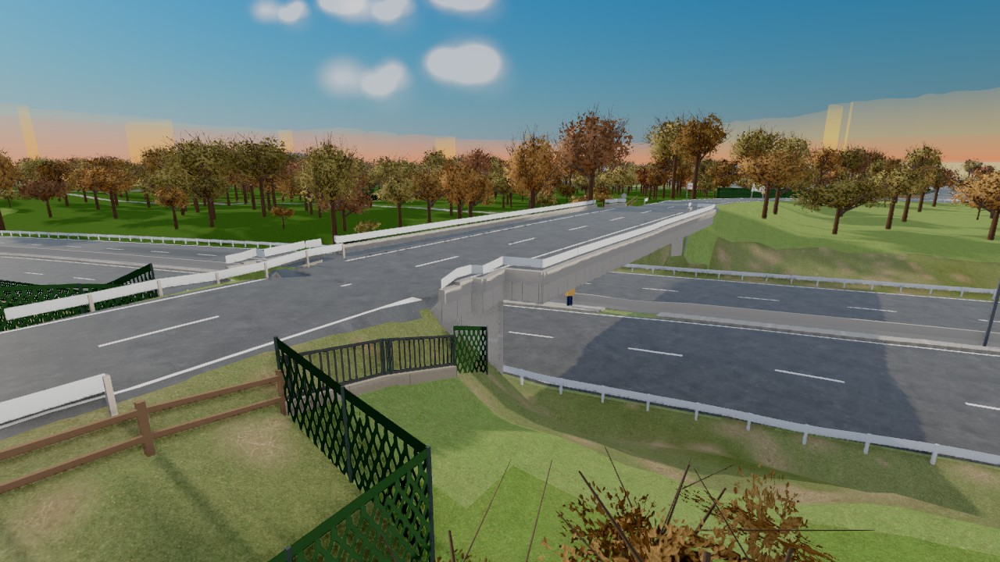
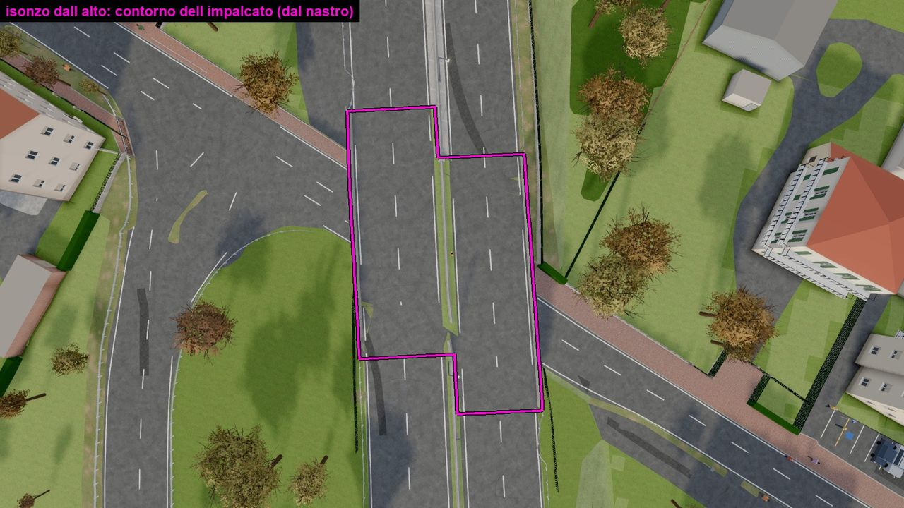
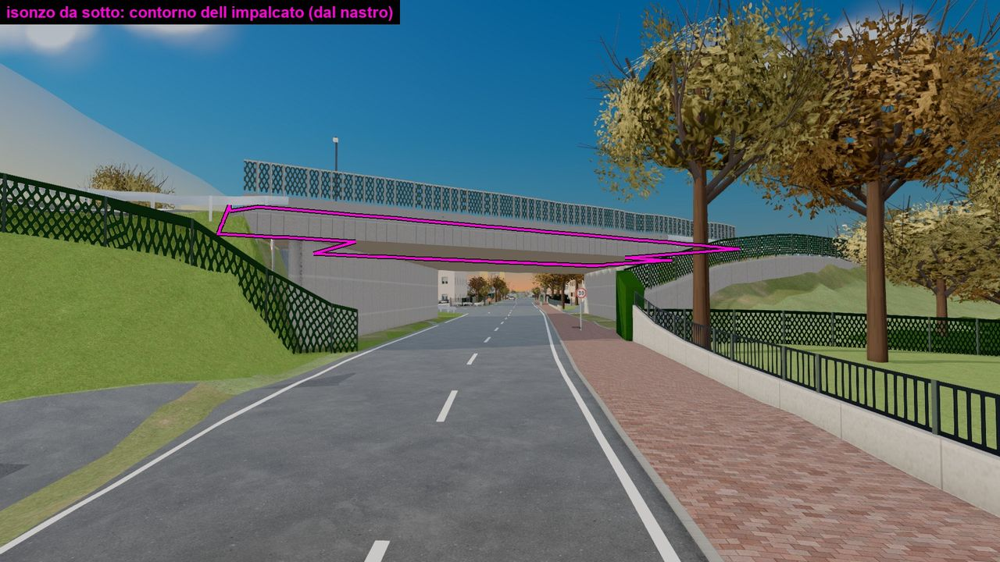
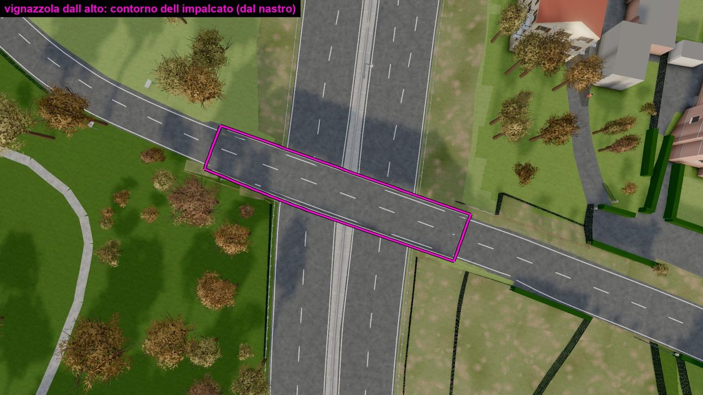

# Nastri: il motore è adatto a un mondo su più livelli?

Analisi del 13/11/2026, ramo `nastri` (solo questo documento, nessuna modifica al gioco). Chiesta da Carlo prima di estendere la mappa verso Seregno e la Valassina.

## In breve

- **Le fondamenta reggono.** Le quote, la fisica e la telecamera lavorano già su più livelli: un suolo unico più delle lastre sopra e sotto, e ogni cosa che si muove chiede "cosa ho sotto, vicino alla mia altezza". Non serve un motore nuovo.
- **Il sospetto di Carlo è giusto per tutto il resto.** Quello che sta nel mondo (asfalto, righe, cordoli, spartitraffico, guardrail, recinzioni, alberi) è salvato come disegno in pianta, senza scritto a che livello sta. La quota la prende dopo, appoggiandosi al suolo. Dove ci sono due livelli ogni famiglia di oggetti indovina il suo con una regola propria: ne ho contate una decina, tutte diverse.
- **Il ponte non è la strada.** È un oggetto a parte, nato dalla sagoma PONTE del DBGT e allungato a quadretti di 2 m per farlo arrivare al terreno. La strada che ci passa sopra ha un'altra forma e un'altra larghezza. Da qui i bordi seghettati e gli attacchi sbagliati: due verità sullo stesso bordo.
- **Cosa cambierei:** la strada diventa un nastro unico nella build (asse con le quote, due bordi, e per ogni tratto se è a raso, su ponte o in galleria). Il ponte è lo stesso nastro in un tratto in cui sotto non c'è terra. Tutto ciò che appartiene alla strada porta scritto il nastro su cui sta e ne prende la quota. Il terreno si adatta al nastro, non il contrario.
- I passi sono sette, ognuno si guarda nel gioco. Il primo che si vede (i ponti dritti, larghi come la strada) è il secondo.

**Limite di questa analisi.** Il codice è 1,4 MB solo nei file che c'entrano e non l'ho letto riga per riga. Ho letto per intero la parte delle quote (`altezze3.js`), nel disegno le parti di `world3.js` che toccano ponti e livelli, e delle build (`impalcati.py`, `opere.py`, `build_data.py`, `dbgt_righe.py`, `guardrail.py` e le altre) le intestazioni e i commenti sui livelli. La fisica l'ho guardata nei punti in cui chiede la quota. I numeri di riga sono di `origin/dev` al commit `0706aa09`.

---

## 1. È adatto a un mondo 3D su più livelli?

### Dove sì

**Le quote (`src/altezze3.js`).** Il mondo è un suolo `S` a griglia di 2 m più tre tipi di lastre: impalcati sopra (`deckAt`, r. 333), fosse e rampe sotto (`pitY`, r. 402), tratti coperti dei sottopassi (`gallAt`, r. 359). La domanda che conta è `H.surface(x, z, cy)` (r. 481): "il piano più alto che sta sotto di me, entro 0,8 m sopra i miei piedi". Sotto un ponte risponde la strada di sotto, sul ponte risponde l'impalcato, in galleria il fondo. Funziona con quanti impalcati si vuole uno sopra l'altro.

**La fisica (`src/fisica3.js`, blocchi in `src/assemble3.py`).** Ruote, scocca, pedoni e giocatore chiedono tutti `H.surface` con la propria altezza. Non c'è nessuna regola per posto: la fisica è già uguale ovunque. I muri hanno piede e cima (`y0`, `y1`) in 23 dei 35 punti in cui `world3.js` li crea, quindi un parapetto del ponte non ferma chi passa sotto.

**La telecamera** conosce i soffitti (`camSlabs`, `camCeil` in `assemble3.py`): impalcati e coperture.

**Il grafo delle strade.** Ogni nodo ha la sua quota, e sa su quale impalcato sta dalla lista delle strade di quell'impalcato (`decks[].ra`, `H.node` r. 495). Traffico e polizia nascono al livello giusto.

Foto: da sotto, il cavalcavia della Milano-Meda su corso Isonzo è un ponte credibile (spalle, soletta, strada che passa).

### Dove no

**a) Gli oggetti del mondo non sanno a che livello stanno.** Nei pezzi della mappa asfalto, marciapiedi, righe, isole, barriere e alberi sono poligoni, linee e punti in pianta. Nel disegno la quota è quasi sempre `H.ground(x, z)`, cioè il suolo `S`, il livello più basso: circa 165 chiamate nei file del gioco (64 in `world3.js`, 54 in `paesaggio3.js`), contro 13 punti di `world3.js` che guardano gli impalcati. Quei 13 punti sono le pezze. Ognuno risponde a modo suo alla stessa domanda, "questa cosa sta sopra o sotto?":

| Cosa | Come decide il livello | Dove |
|---|---|---|
| Spartitraffico | un segno messo dalla build (`dk`), altrimenti guarda se le carreggiate parallele vicine sono sopraelevate | `world3.js` r. 331-336 `medianDeck` |
| Righe | livello 1 o 2 dalla build; poi "sul ponte se sotto non passa una strada, o se il ponte è a meno di 2,5 m dal suolo" | `world3.js` r. 2037-2044 `topS` |
| Asfalto | sul ponte solo se sotto c'è acqua o campo (`free`) | `altezze3.js` r. 471-475 `H.street` |
| Asfalto delle rampe | niente vernice nelle celle sotto l'impalcato, tranne dove passa un'altra strada entro mezza larghezza + 1 m | `world3.js` r. 1371-1380 `rampPaint`, `ud2` |
| Cordoli | tagliati a pezzi di 1 m per saltare le celle sotto il ponte | `world3.js` r. 1083 |
| Guardrail, piloni, binari vecchi | "l'impalcato più vicino alla quota vecchia, entro 3 m" | `world3.js` r. 1148-1155 `deckY` |
| Piloni | non dove a terra c'è asfalto, alveo o binario entro 3,4 m | `world3.js` r. 1318-1325 `busyGround` |
| Muri sopra un sottopasso | il piede del muro alzato sopra il soffitto, intercettando ogni muro creato | `world3.js` r. 1544-1546 |
| Prati | terra nuda nelle celle sotto un impalcato | `world3.js` r. 1735-1737 |
| Suolo sopra la bocca di un sottopasso | "almeno la cima dell'opera" nelle celle della trincea | `altezze3.js` r. 413-419 `sopraCoperto` |

Lo stesso nella build: le regole lavorano con le distanze in pianta e il livello è stato aggiunto dopo, una regola alla volta, quasi sempre dopo una segnalazione di Carlo. In `build_data.py`: la recinzione della ferrovia che si apriva sotto la Milano-Meda perché la strada "attraversa" i binari in pianta (r. 934-938 e 991), i muri a terra sotto i ponti (r. 1294), le isole e i prati finiti sopra o sotto l'impalcato (r. 2721-2744). In `guardrail.py` i guardrail "si aprono sui ponti" (r. 11).

È la prova più diretta: i casi segnati in `todo.md` sotto "Il gioco non è 2D" (strisce del ponte cancellate da quelle di sotto, guardrail della Milano-Meda su corso Isonzo, spartitraffico interrotto sotto la rampa) sono la stessa domanda che riceve risposte diverse da regole diverse.

**b) Il ponte è un oggetto diverso dalla strada.** `impalcati.py` costruisce l'impalcato dalla sagoma PONTE (il "nucleo"), poi lo allunga con le celle da 2 m della griglia del terreno per farlo arrivare dove trova suolo alla sua quota: celle di spalla, prolungamenti fino a 12 m, rampe fino a 40 m (r. 25-36 e 445, 547, 569). Fuori dal nucleo il bordo dell'impalcato corre quindi sulle linee della griglia, a scalini. I parapetti seguono quel bordo (`deckOutline`, `world3.js` r. 1307-1316, il commento dice proprio "in 2 m steps"). La strada invece nasce dall'asse con la sua larghezza e l'asfalto dai poligoni AC_VEI. Tre geometrie per lo stesso bordo.

Dall'alto, x 346 z 1998: i due bordi dell'impalcato fanno i denti, il parapetto li segue, lo spartitraffico piega dove comincia il ponte.

Lo stesso bordo dal ciglio: il parapetto a pezzi sfalsati dove dovrebbe continuare la linea della strada.

Via Vignazzola, x -20 z 769: il ponte è più largo della strada che ci arriva, al capo est c'è un dente, le righe di bordo della strada e del ponte non sono sulla stessa linea.

I rami parcheggiati lo confermano. `ponti-come-strada` (largo come la strada) veniva stretto, `ponti-imbuto` (largo come il DBGT con un raccordo) veniva largo. Tutti e due correggono il bordo nel gioco, dopo che la build ha già prodotto due forme diverse: una delle due resta sempre sbagliata. Tutti e due, poi, cambiano solo `altezze3.js` e `world3.js`: la build non la toccano.

**c) Il suolo ha una quota sola per punto e quadretti di 2 m.** Dove due livelli sono vicini in pianta (il fianco di un ponte, la bocca di un sottopasso, una rampa accanto alla strada di sotto) un quadretto ha un angolo su un livello e uno sull'altro e disegna un telo inclinato. Da qui: il gradino dei fianchi (`impalcati.py` r. 569-571, "a walker went up it in one frame"), i teli grigi nelle bocche (`sopraCoperto`), le celle senza vernice (`ud`). Le fosse bucano il terreno a celle intere (`F.pc`) e il gioco ridisegna a mano il suolo attorno. Sotto un ponte, poi, il LiDAR non vede: il suolo lì va ricostruito (`opere.py`, r. 15-19).

**d) Sotto terra c'è un piano solo.** In un punto si trova una fossa oppure una galleria, la prima che capita (`pitY` e `gallAt` si fermano al primo triangolo). Un parcheggio interrato su due piani oggi non si può descrivere. Sopra terra invece gli impalcati si sommano senza limite.

**e) Dove il DBGT non ha un PONTE la strada non ha ponte.** A corso Isonzo sul Seveso (x -684.7 z 1687.7) entro 70 m dal punto non c'è nessun impalcato: la strada è bruciata nel suolo e scende col terreno verso il torrente. È la "depressione importante" segnata da Carlo il 9/11.

### Perché è nato così

Il motore nuovo (`docs/motore.md`) è partito dal problema giusto di allora: cinque funzioni davano cinque quote diverse. La risposta è stata una superficie unica, con ponti e fosse come eccezioni ("gli unici oggetti che stanno sopra o sotto", §0). Per le quote ha funzionato. Ma il modello è rimasto "il suolo più alcune eccezioni", e ogni cosa disegnata è figlia del suolo. In un mondo su più livelli le strade devono essere cittadine di prima classe e il suolo deve stare loro attorno.

---

## 2. Cosa cambierei alla radice

### Il nastro

Nella build ogni carreggiata diventa un **nastro**:

- un asse in 3D (gli assi EL_STR del DBGT hanno già la quota di ogni vertice, ponti compresi: `build_data.py` r. 283);
- due bordi, misurati di traverso all'asse a ogni metro sulla carreggiata AC_VEI (lo fa già `dbgt_righe.py` per le righe, r. 7-10: linea di mezzo e due bordi lisciati);
- per ogni tratto la **sede**: a raso, su ponte, in galleria o trincea. Il DBGT la scrive su assi e aree (`SED` e `LIV`, già letti da `dbgt_quote.py` r. 28-35);
- un numero suo.

Da qui quattro regole.

1. **Il ponte è un tratto del nastro.** Dove la sede è "ponte" la build non brucia la strada nel suolo e produce l'impalcato dalla sezione del nastro: stessa larghezza, stessi bordi lisci, soletta sotto, parapetti sul bordo. Il ponte comincia e finisce a una stazione dell'asse, con un taglio dritto di traverso: lì c'è la spalla. Spariscono le celle di spalla, i prolungamenti, le rampe a quadretti, la correzione dei fianchi. La sagoma PONTE resta come controllo (dice dove deve esserci un ponte e quanto è lungo).
2. **Il sottopasso è un tratto del nastro.** Dove la sede è "galleria" o l'asse sta sotto il suolo, la build produce fondo, pareti e soletta dalla sezione del nastro. `opere.py` fa già così ("l'opera è un pezzo solo, e prima viene lei; poi il terreno e la vernice si tagliano attorno al suo contorno", r. 10-11): diventa la regola di tutti, non un flusso a parte.
3. **Ogni cosa della strada porta scritto il suo nastro.** Righe, spartitraffico, cordoli, marciapiedi, guardrail, lampioni, cartelli escono dalla build con il numero del nastro (o 0 per "a terra"). Il gioco chiede la quota a quel nastro, senza indovinare. Le dieci regole della tabella sopra diventano una.
4. **Una sola funzione "stesso livello" nella build.** Due cose si toccano, si tagliano o si escludono solo se sono allo stesso livello: stesso nastro, o quote entro una tolleranza nel punto in cui si incontrano. Recinzioni, muri, cancelli, alberi, doppioni usano quella, e non la distanza in pianta.

### Nel gioco

- **Una lastra sola al posto di tre.** Impalcati, fosse e gallerie diventano lo stesso oggetto: triangoli con un piano di sopra e, se c'è, un soffitto. `H.surface(x, z, cy)` resta com'è, guarda tutte le lastre. Un parcheggio su tre piani sono tre lastre e i nastri delle rampe, sopra o sotto terra.
- **Il terreno si taglia sul contorno, non a quadretti.** Dove un nastro scende sotto il suolo la maglia del terreno si ritaglia lungo il suo bordo. Il ritaglio dei poligoni sulla griglia esiste già (`clipPoly`, `altezze3.js` r. 279) e oggi serve a stendere le superfici: va usato anche per bucare.
- `H.on(livello, x, z)` per chi disegna: la quota del nastro o della lastra indicata.

### Il terreno sotto e attorno

Il suolo `S` resta la griglia di oggi, ma è il nastro che comanda: a raso la strada si brucia nel suolo come ora; su ponte e in galleria il suolo resta quello che c'è sotto o sopra (un altro nastro, o il terreno del DBGT e del LiDAR). Dove una strada passa su un corso d'acqua il nastro tiene il suo profilo e l'alveo continua sotto.

### Alternative considerate

| Alternativa | Perché la scarto |
|---|---|
| **Mondo tutto a maglie 3D con un motore fisico generico** (collisioni su triangoli) | Butta la fisica dell'auto che Carlo ha messo a punto e che già lavora su più livelli. I dati sono in pianta con la quota (DBGT, LiDAR): un suolo più lastre li rappresenta esattamente. Costo molto alto, nessun difetto di oggi viene da lì. |
| **Più griglie del suolo, una per livello** | I livelli non sono globali: il "piano 1" di un cavalcavia non è quello di un parcheggio. I bordi resterebbero a quadretti di 2 m, che è proprio il difetto. |
| **Griglia più fitta attorno ai ponti** (0,5 m) | I denti diventano più piccoli ma restano, e i quadretti continuano a mescolare due livelli. Più dati per lo stesso errore. |
| **Continuare a correggere nel gioco** (`ponti-imbuto`, `ponti-come-strada`) | Già provato due volte: con due forme diverse dello stesso bordo una resta sbagliata. E ogni comune nuovo porta casi nuovi. |
| **Sistemare solo i ponti e lasciare il resto in pianta** | Toglie i denti, ma righe, spartitraffico e guardrail continuerebbero a indovinare il livello. Sugli svincoli della Valassina (rampe sopra rampe) le dieci regole si contraddicono. |
| **Livello scritto a mano o per coordinate nei casi difficili** | Contro la regola: niente pezze, niente coordinate per comune. |

---

## 3. Cosa terrei com'è

- **`H.surface(x, z, cy)` e tutta la fisica.** È il pezzo già 3D. Cambia solo da dove arrivano le lastre.
- **Il suolo `S`** (griglia, pezzi, cucitura, materiali per cella) e il **ritaglio delle superfici sulla griglia**: asfalto e prati a raso stanno esattamente sul terreno, ed è giusto così.
- **La lettura del DBGT**: pulizia delle quote, aggancio delle vie OSM agli assi EL_STR (`dbgt_strade.py`), misura dei bordi della carreggiata (`dbgt_righe.py`). Il nastro è fatto con questi pezzi: vanno messi insieme, non riscritti.
- **I binari.** `binari.py` dà già ai binari un profilo proprio, liscio, e il gioco ci disegna sopra rotaie e massicciata (`altezze3.js` r. 122-139). È un nastro, fatto dopo gli stessi problemi, e ha funzionato.
- **`opere.py`** come idea: l'opera prima, terreno e vernice tagliati attorno.
- **I muri con piede e cima**, da estendere ai 12 punti che ancora non li hanno.
- **I controlli** (`controlli_ponti.py`, `controllo_strisce_ponti.py`, il controllo `di_traverso`): diventano il collaudo di ogni passo.
- **Il caricamento a pezzi**, la build attorno al punto, i rapporti.

---

## 4. I passi

Ogni passo finisce con qualcosa che Carlo guarda. I punti di prova fissi: Milano-Meda su corso Isonzo (x 346 z 1998), via Vignazzola (x -20 z 769), Milano-Meda sulla ferrovia (x 417 z 2243), corso Isonzo sul Seveso (x -685 z 1688), bocca sud del sottopasso della Milano-Meda (x -769 z 118), via Montecassino (x 754 z 2132), più i sei casi `di_traverso` di `todo.md`.

**0. Il metro.** Un controllo su tutta la mappa che conta le cose disegnate a un livello che non è il loro (una riga, un cordolo, un guardrail, una recinzione entro pochi centimetri da una lastra o dal suolo di un altro livello), con il link di ogni caso. Nessuna correzione. *Si vede:* un numero di partenza e l'elenco; è l'"elenco delle regole in pianta" chiesto da Carlo, fatto dai casi e dalla tabella del §1.

**1. Il nastro nella build, senza cambiare il gioco.** Un modulo nuovo produce i nastri (asse, bordi, sede per tratto) e il gioco, con un parametro nel link, li disegna come due linee colorate alla loro quota. *Si vede:* le linee seguono il bordo dell'asfalto in tutta la mappa, sui ponti stanno in alto e dritte, nei sottopassi in basso. Dove non combaciano, si capisce prima di costruirci sopra.

**2. Il ponte dal nastro.** Impalcato, spalle e parapetti dalla sezione del nastro; via l'allungamento a quadretti. *Si vede:* ai punti di prova i bordi sono dritti e in linea con la strada, sopra e sotto; `controlli_ponti` a 0; i sei casi `di_traverso` chiusi. È il passo che risponde a "tirarlo bello dritto come la strada di fianco".

**3. Le cose della strada sul loro nastro.** Righe, spartitraffico, cordoli, marciapiedi, guardrail, lampioni e cartelli prendono il numero del nastro nella build e la quota da lì. Una famiglia alla volta, togliendo ogni volta la regola vecchia della tabella. *Si vede:* stesso oggetto cercato sopra e sotto ogni ponte; il numero del passo 0 scende a ogni famiglia.

**4. Una lastra sola e il terreno tagliato sul contorno.** Impalcati, fosse e gallerie diventano lo stesso oggetto; il terreno si buca lungo il bordo del nastro. *Si vede:* le bocche dei sottopassi senza teli né gradini (x -769 z 118, via Montecassino, scale della stazione).

**5. I corsi d'acqua.** Una strada che passa sull'acqua è un tratto su ponte anche dove il DBGT non ha la sagoma PONTE, con una regola unica (domanda 4). *Si vede:* corso Isonzo sul Seveso senza conca, con un ponte riconoscibile.

**6. Le regole della build con "stesso livello".** Recinzioni, muri, cancelli, alberi, doppioni. *Si vede:* il numero del passo 0 a zero su tutta la mappa, e resta nei rapporti della build come soglia.

**7. La prova vera.** Il primo svincolo della Valassina a Seregno, senza regole nuove. Se servono pezze, il modello non è finito. Poi il primo parcheggio su più piani (domanda 5).

Quanto è grosso: i passi 1 e 2 sono quasi tutti nella build e sono il cuore; il 3 è lungo ma meccanico (una famiglia per volta); il 4 tocca il terreno ed è il più delicato. Ogni passo vuole una build completa. Non do una stima in giorni: dipende da quante famiglie del passo 3 si fanno per giro.

---

## 5. Domande per Carlo

1. **Larghezza del ponte.** Propongo: la carreggiata del nastro (i bordi AC_VEI misurati dal DBGT, gli stessi delle righe), più il marciapiede dove il DBGT lo dà, e il parapetto subito fuori. La sagoma PONTE serve solo a dire dove comincia e finisce il ponte. Va bene, o vuoi che il ponte resti largo come la sagoma PONTE con la strada che ci si adatta?
2. **Da dove partire.** L'ordine che avevi detto era elenco, nastro, conversione, controllo. Lo tengo, ma propongo di convertire per primi i ponti (passo 2) così vedi subito un risultato su corso Isonzo, e le altre famiglie dopo. D'accordo?
3. **Comuni senza DBGT.** Il nastro prende forma e quote dal DBGT. I comuni che aggiungiamo (Seregno e gli altri) lo hanno tutti? Dove manca, il nastro si farebbe dall'asse OSM con larghezza OSM e quote dal LiDAR: i ponti lì avrebbero la quota stimata fra le due spalle.
4. **Strade sull'acqua senza PONTE nel DBGT.** Regola proposta: se una carreggiata passa sopra un alveo, quel tratto è un ponte (profilo della strada dritto fra le due sponde, alveo che continua sotto, parapetti). Oppure preferisci il tombino: strada a raso e acqua che entra in un tubo, coi parapetti sopra le bocche?
5. **Parcheggi su più piani.** I dati dicono che esistono (OSM) e la sagoma dell'edificio, non come sono fatti dentro: piani, rampe, pilastri. Costruirli vuol dire inventare l'interno con una regola. Si fa (interno neutro, uguale per tutti) o restano scatole chiuse finché non c'è una fonte?
6. **Misure che il DBGT non dà.** Spessore della soletta e tipo di parapetto oggi sono valori generici (0,9 m; parapetto di cemento con corrimano, ringhiera sulle passerelle). Li tengo così?

### Le risposte di Carlo (13/11)

1. Il ponte è largo come la strada: carreggiata misurata dal DBGT, marciapiede dove c'è, parapetto subito fuori. La sagoma PONTE dice solo dove comincia e dove finisce.
2. Dopo i passi 0 e 1 si parte dai ponti (passo 2).
3. Comuni senza DBGT non ce ne saranno: tutti quelli dentro il confine lo hanno.
4. Strada su un corso d'acqua senza PONTE nel DBGT: se il corso d'acqua è largo oltre 4-5 m è un ponte (strada dritta fra le sponde, acqua scoperta sotto, muretto con ringhiera ai lati); sotto quella larghezza un tombino. Caso tipo: corso Isonzo sul Seveso (x -685 z 1688), dal vero strada piatta, Seveso scoperto in un canale con muri di cemento.
5. Parcheggi su più piani: per ora niente.
6. Soletta 0,9 m. Parapetto per tipo di strada: sulle superstrade (Milano-Meda, Valassina) new jersey di cemento con rete sopra; sulle strade normali muretto di cemento con ringhiera o corrimano; sulle passerelle ringhiera.

---

## 6. Passi 0 e 1: fatti (14/11)

Il gioco non cambia: senza `&nastri=1` nel link non si carica e non si disegna niente di nuovo. Nessuna correzione in questo giro.

### Passo 1, il nastro nella build

- `src/nastri.py` (lo lancia `build.py` dopo `build_data.py`; da solo: `python src/nastri.py`, mezzo minuto). Scrive `mappa/nastri.bin` e `report_nastri.json`.
- Un nastro è una carreggiata: gli elementi EL_STR uniti capo a capo come fa `dbgt_righe.py` per le righe, con la quota del DBGT a ogni vertice, una stazione al metro. **866 nastri, 196 km**: 195,0 a raso, 0,60 su ponte (SED 02), 0,07 in galleria (SED 03), 0,28 "sotto" (LIV 01: il pezzo di strada che passa sotto un'altra opera).
- I due bordi si misurano di traverso sull'AC_VEI **alla stessa quota** della stazione (entro 2,5 m). È la prima regola "stesso livello" scritta nella build: il bordo della strada che passa sotto un ponte sta a un'altra quota e il raggio non lo vede; il capo del ponte, dove l'area su ponte e quella a raso si toccano alla stessa quota, non è un bordo e si toglie. Senza questa regola sul ponte di corso Isonzo il nastro veniva largo 1,5 m.
- Dove un bordo si apre (imbocchi, incroci, piazzali) si porta dritto fra prima e dopo: 31 km di bordo su 392 sono portati così; l'elenco è in `report_nastri.json` (`bordo_portato`). Larghezza: mediana 7,3 m.
- La trincea scoperta il DBGT non la scrive (SED e LIV dicono solo ponte, galleria e "sotto"): la dirà la quota dell'asse rispetto al terreno, al passo 4.
- Nel gioco `src/nastri3.js`: con `&nastri=1` i due bordi di ogni nastro alla loro quota, visibili attraverso tutto (giallo a raso, magenta ponte, azzurro galleria, arancio sotto); con `&nastri=2` stanno dietro a quello che li copre.

Cosa mostrano le linee ai punti di prova (foto in `docs/nastri_foto/`, `passo1_*`):

| Punto | Cosa si vede |
|---|---|
| Milano-Meda su corso Isonzo (x 346 z 1998) | sul ponte le due carreggiate sono dritte e in alto, larghe come l'asfalto prima e dopo; l'impalcato del gioco è più largo e a denti. Il tratto "ponte" del DBGT è lungo 24 m, la parte sopraelevata prima e dopo è a raso su rilevato |
| via Vignazzola (x -20 z 769) | il nastro passa dritto sopra la Milano-Meda, più stretto dell'impalcato del gioco; sotto, i pezzi della Milano-Meda sono "sotto" |
| Milano-Meda sulla ferrovia (x 417 z 2243) | carreggiate in alto e dritte; via don Sturzo e i binari sotto |
| corso Isonzo sul Seveso (x -685 z 1688) | il nastro è a raso e piatto (15,37 m) e il suolo del gioco sull'asse è alla stessa quota: sull'asse la conca non c'è. Il DBGT lì non ha né PONTE né SED 02: il ponte sull'acqua lo farà il passo 5 |
| bocca sud del sottopasso della Milano-Meda (x -769 z 118) | il tratto coperto è galleria (azzurro) e sta in basso; le rampe sono a raso e scendono con la quota del DBGT |
| via Montecassino (x 754 z 2132) | il sottopasso della ferrovia è galleria, in basso, e le rampe scendono |

Dove nastro e strada del gioco non combaciano:

- **In quota**, su tutta la mappa (`strada_fuori_quota` in `report_livelli.json`): **17 tratti, 193 m** in cui sull'asse del nastro nessun piano del gioco sta entro 0,6 m dalla quota del DBGT. Nessuno ai punti di prova; i più lunghi: via Santa Maria (x -192 z -2597, 64 m, il gioco 1,5 m più basso), via Cascina Bricola (x -1320 z 2320), via Marziali (x -1432 z 1065), via Conte Ugo di Carpegna (x 536 z -1343).
- **In pianta**: i bordi sono misurati sull'AC_VEI, lo stesso da cui il gioco stende l'asfalto, quindi a raso combaciano dove sono misurati. Non combaciano per costruzione nei tratti di `bordo_portato` (incroci e imbocchi) e sui ponti, dove l'impalcato del gioco è più largo del nastro e ha i denti: è quello che corregge il passo 2.

### Passo 0, il metro

- `src/controllo_livelli.mjs` (lo lancia `pezzi.py` dopo `controlli_ponti.mjs`; da solo: `node src/controllo_livelli.mjs http://127.0.0.1:<porta>/ report_livelli.json --elenco`, un minuto). Scrive `report_livelli.json`, con un link per caso.
- Gira nel gioco (`?tutto`) e guarda quello che il gioco ha disegnato davvero: stende le maglie dei tile che toccano un posto a più livelli (82 tile: entro 25 m da un impalcato, una fossa, una galleria o un tratto di nastro non a raso). Le maglie delle famiglie portano un'etichetta (`userData.fam`, messa in `world3.js` dove si creano: unica modifica al disegno, senza effetto).
- Le cose della strada (righe, cordoli, spartitraffico, guardrail, parapetti): ogni triangolo che cade sopra un nastro e corre lungo di lui (entro 30 gradi) appartiene a quel nastro; se più nastri lo coprono, a quello più vicino in quota. È sbagliato se sta sotto o sopra la quota del suo nastro oltre la tolleranza (righe 0,5 m; cordoli da -0,5 a +0,8; spartitraffico e guardrail fino a +1,6; parapetti 0,8). Quello che attraversa (strisce pedonali, linee d'arresto) e i paletti non si guardano: non si sa di chi sono.
- Recinzioni e muri: il piede non sta sul piano che ha sotto (oltre 0,6 m). Alberi: sotto un impalcato, entro la loro altezza.
- I campioni sbagliati si raccolgono in casi (celle di 8 m per famiglia).

**Numero di partenza: 115 casi** (righe 34, cordoli 12, spartitraffico 10, guardrail 12, parapetti 15, recinzioni 32, alberi 0), più la strada fuori quota (17 tratti, 193 m) che si conta a parte.

Cosa c'è dentro, per tipo (i casi non li ho guardati tutti uno per uno: ho controllato a campione che le classi tornino con i difetti noti):

- righe disegnate al suolo sotto il loro ponte, 5-7 m più in basso: Milano-Meda su corso Isonzo (x 328 z 1984, x 343 z 1985), sul viale Francia (x -517 z 143), via Vignazzola (x -37 z 767);
- righe sotto l'impalcato lungo le rampe, 1-3 m più in basso: via Ravenna sul cavalcaferrovia (x 1402 z 490), svincolo della Milano-Meda (x 44 z 506);
- spartitraffico e cordoli del ponte disegnati sulla strada sotto: via Senofonte (x 26 z 955), via Vignazzola (x -22 z 770), via dei Vignee (x 174 z 1441);
- guardrail e parapetti a 5-8 m sopra la strada lungo cui corrono: i pezzi di parapetto che ai capi dei ponti girano lungo la strada di sotto (le scalette del reticolo: Vignazzola x -4 z 766, corso Isonzo x 334 z 2008, via Marco Polo x 52 z 462);
- cordoli fuori quota in via Farga (x -984 z 88) e in viale Vittorio Veneto (x -1245 z 1088);
- recinzioni col piede 1-3 m sopra o sotto il piano (32 casi): la più sparsa, da guardare al passo 6.

**Limiti del metro.** Vede le cose al livello sbagliato, non quelle che mancano (per le strisce che mancano sui ponti c'è `controllo_strisce_ponti.py`). Asfalto, lampioni e cartelli non hanno ancora la loro misura: l'asfalto è coperto in quota dalla strada fuori quota; lampioni e cartelli entrano quando prendono il numero del nastro (passo 3). Dove due nastri corrono paralleli uno sopra l'altro sceglie il più vicino in quota, quindi lì non può sbagliare a favore: sugli svincoli della Valassina andrà riguardato.

---

## 7. Passo 2: i ponti dal nastro (14/11, tag `nastri/passo2`)

L'impalcato di un ponte stradale non nasce più dalla sagoma PONTE allungata a quadretti: nasce dai nastri che ci passano sopra (`src/ponti_nastro.py`, chiamato da `impalcati.py`). Terreno, build e pezzi rifatti su tutta la mappa.

### La regola

- **Dove sta il ponte.** Un nastro è sul ponte nelle stazioni dentro la sagoma PONTE *alla quota del suo piano* (entro 1,5 m: la strada che passa sotto è dentro la sagoma in pianta ma a un'altra quota e non conta). Da lì il tratto continua una stazione alla volta finché sotto la sezione il suolo sta più di 0,5 m sotto il nastro o non è un piano solo (un pezzo della sezione è già sul vuoto: il ciglio della spalla). Finisce alla prima stazione con il suolo alla sua quota: lì c'è il capo, un taglio dritto di traverso all'asse.
- **La sezione.** I due bordi del nastro (la carreggiata misurata sull'AC_VEI), il marciapiede dove il DBGT lo dà accanto alla carreggiata alla stessa quota, più 0,6 m per lato: il cordolo che porta il parapetto, subito fuori.
- **Più nastri sullo stesso PONTE** (le due carreggiate della Milano-Meda) fanno un impalcato solo: la fessura fra due strisce fino a 6 m si chiude, lo spartitraffico sta sul ponte.
- **La quota.** Il profilo del nastro, portato sul suolo ai due capi: lo scarto fra nastro e suolo lungo il taglio di un capo (con la sua pendenza di traverso) sposta l'impalcato di quel tanto, da un capo all'altro in linea retta. I vertici sul taglio prendono la quota del suolo esatta: fra ponte e strada non c'è gradino né fessura.
- **I ponti che il DBGT non segna.** Lo stesso: un tratto di nastro in aria dove il terreno dice che la strada non poggia (i nodi AIR di `superficie.py`), lungo almeno 6 m e alto almeno 1,5 m, è un ponte. La Milano-Meda sul Taro (x -248 z 210) ora è fatta così; la campata nord del cavalcaferrovia di via Ravenna (x 1418 z 440), che il DBGT non segna, è un pezzo solo col suo PONTE.
- **Un PONTE stradale senza nastro suo** che sta dentro un impalcato fatto dal nastro è un pezzo di quel ponte e non fa un impalcato (il PONTE doppio al confine fra Meda e Seveso in via Vignazzola, le strisce di marciapiede lungo la Milano-Meda sulla ferrovia).
- **I parapetti** seguono il contorno dell'impalcato, cioè il bordo liscio del nastro, 0,3 m dentro il bordo (sul cordolo). Mai sul taglio di un capo né di traverso a una strada che entra sul ponte alla sua quota. Per tipo di strada: sulle superstrade (`roads[].x`) new jersey di cemento con la rete sopra fino a 2,2 m; sulle altre strade muretto di cemento con corrimano; sulle passerelle ringhiera.
- **Le spalle** (i muri sotto) restano dove il terreno le ha scavate, lungo la sagoma PONTE: è lei che dice dove comincia e finisce il ponte. Il guardrail della superstrada si attacca al capo del parapetto nuovo.
- **Assi ricuciti.** Al confine fra due comuni l'asse EL_STR di ognuno finisce al suo confine e in mezzo resta un buco, in via Vignazzola (x -260 z 689) proprio su un ponte. Due capi liberi che si guardano entro 15 m, nella stessa direzione e alla stessa quota, ora sono la stessa strada: 6 in tutta la mappa (`nastri.py` `_ricuci`). I nastri passano da 866 a 860.

Via dai ponti stradali: celle di spalla, prolungamenti, rampe a quadretti, celle sotto la via OSM, correzione dei fianchi. Nel codice restano per i ponti che non sono ancora fatti dal nastro (sotto).

### I numeri

| | prima (passo 1) | dopo |
|---|---|---|
| ponti stradali fatti dal nastro | 0 | 23 sui PONTE + 1 non segnato (31 strisce) |
| capi dei ponti fuori soglia (`controlli_ponti.py`: gradino o vuoto al capo) | 5 | 2 (tutti e due su ponti non ancora dal nastro) |
| angoli a scatto dei parapetti (`controlli_ponti.mjs`) | 108 | 17 (nessuno sui ponti dal nastro) |
| parapetti di traverso a una strada | 12 | 5 (nessuno sui ponti dal nastro; uno è il PONTE 2 abbuonato) |
| muri sotto i ponti con asfalto dai due lati | 8 | 8 |
| parapetti, metri | 1881 | 1928 |
| **metro dei livelli** | **115** | **106** |
| di cui righe / cordoli / spartitraffico | 34 / 12 / 10 | 39 / 15 / 11 |
| di cui guardrail / parapetti | 12 / 15 | 4 / 2 |
| di cui recinzioni | 32 | 35 |
| strada fuori quota | 17 tratti, 193 m | 16 tratti, 196 m |

Righe, cordoli e spartitraffico salgono di poco: sono le cose disegnate sul suolo nei tratti dove ora c'è l'impalcato vero (prima c'era un impalcato largo a quadretti e la regola "sopra o sotto" indovinava diverso). Le sistema il passo 3, famiglia per famiglia.

I sei casi `di_traverso` di `todo.md`: chiusi PONTE 10000020 (x -1328 z 672), PONTE 6 (x 1422 z 462), PONTE 16 (x 79 z -205), PONTE 8 (x 54 z 356). Restano il ponticello nel bosco PONTE 10000027 (x -2593 z 1479) e la rampa senza nome (x 261 z 1794): sono una passerella e un pezzo di rampa senza asse nel DBGT, non hanno un nastro.

### Le foto

Contorno dell'impalcato evidenziato in magenta. In `docs/nastri_foto/`:

| Punto | Sopra | Sotto |
|---|---|---|
| Milano-Meda su corso Isonzo (x 346 z 1998) | `passo2_isonzo_alto.jpg`, `passo2_isonzo_lato.jpg` | `passo2_isonzo_sotto.jpg` |
| via Vignazzola (x -20 z 769) | `passo2_vignazzola_alto.jpg`, `passo2_vignazzola_lato.jpg` | `passo2_vignazzola_sotto.jpg` |
| Milano-Meda sulla ferrovia (x 417 z 2243) | `passo2_ferrovia_alto.jpg` | `passo2_ferrovia_sotto.jpg` |
| i sei `di_traverso` | `passo2_t1_…` fino a `passo2_t6_…` (`_alto`) | `passo2_t2_ponte6_sotto.jpg`, `passo2_t5_ponte8_sotto.jpg` |

### Cosa resta aperto

- **Ponti non ancora dal nastro (metodo vecchio, coi quadretti):** le 14 passerelle, i 3 ponti della ferrovia, il PONTE 10000005 (x -1298 z 1664, solo marciapiede nel DBGT) e la rampa senza nome di x 254 z 1793. Non hanno un nastro perché i nastri sono le carreggiate EL_STR. Servono i nastri dei binari (EL_FER) e dei percorsi pedonali: stessa regola, altro asse. Da qui vengono i 2 capi fuori soglia, i 17 scatti e 4 dei 5 parapetti di traverso che restano.
- **Ponti di sbieco.** Ogni carreggiata finisce con un taglio dritto di traverso al suo asse: su un ponte molto di sbieco (Milano-Meda sul viale Francia, x -530 z 140) l'impalcato copre anche i due triangoli sopra le spalle, e le due carreggiate finiscono sfalsate. Da sopra la strada è dritta; da sotto si vedono le spalle di sbieco con la soletta che le scavalca.
- **Sul ponte di corso Isonzo** il new jersey dello spartitraffico si interrompe e le righe della campata nord di via Ravenna stanno ancora sul suolo sotto l'impalcato: famiglie del passo 3.
- **PONTE 16 (x 79 z -205):** il parapetto di traverso non c'è più, ma in mezzo all'asfalto è rimasto un muretto con la rete a Z: è un divisore del DBGT (famiglia recinzioni, passo 6).
- Controlli del terreno: le spalle combaciano (p99 0,013 m), un lato a 0,26 m sul ponte del Taro (soglia 0,2); 4 nodi AIR restano senza impalcato sopra (x -1311 z 1542).
